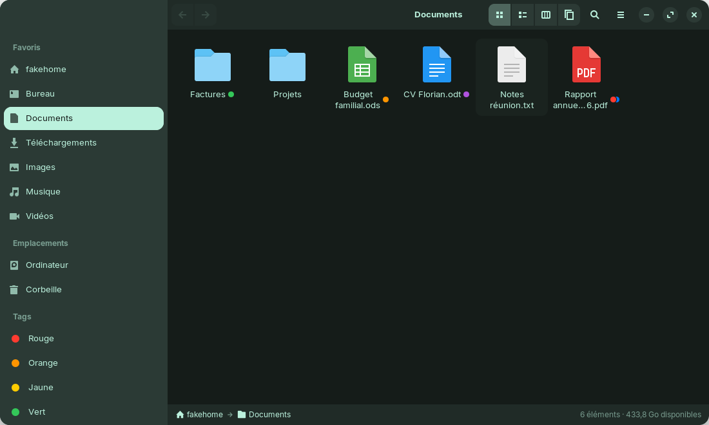
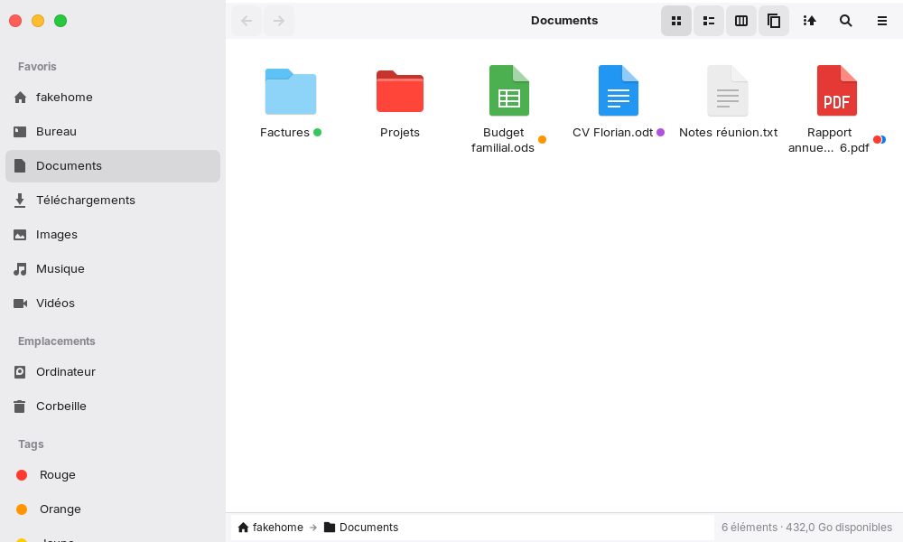
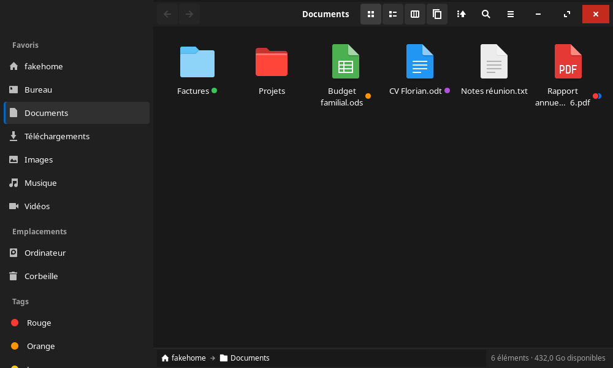

<p align="center">
  
</p>

# Galet

**A Finder-inspired file manager for GNOME / Zorin OS / Ubuntu.**
Free and open source software by **[Florian Dérail](https://florianderail.fr)**.
*Un gestionnaire de fichiers inspiré du Finder d'Apple, pour GNOME.*



🇫🇷 **Présentation et tutoriel d'installation en français : [docs/FICHE.md](docs/FICHE.md)** ·
**Nouveautés : [CHANGELOG.md](CHANGELOG.md)**

> *« Je n'ai jamais trouvé un explorateur de fichiers qui me convienne vraiment.
> Alors j'ai développé le mien, exactement comme je le voulais. »* — Florian Dérail
>
> *"I never found a file manager that really suited me, so I built my own, exactly the way I wanted it."*

Galet brings the parts of macOS Finder people miss most on Linux, while
staying a native GTK4 / libadwaita application that blends in with GNOME and Zorin OS.

## Features

**Finder essentials**
- **Colour tags**: right-click a file and pick a coloured dot. Tags appear next to names in every
  view and in the sidebar, where one click lists every file with that tag. Named tags
  ("Invoices", "Work"…) are supported too.
- **Four views**: Icons, List (sortable, groupable by kind, date or tag), **Columns** (Miller
  columns with preview) and **Gallery** (large preview + thumbnail strip), with
  <kbd>Ctrl</kbd>+<kbd>1</kbd>…<kbd>4</kbd>.
- **Tabs**, path bar, status bar, **Quick Look** (<kbd>Space</kbd>), **preview pane**
  (<kbd>Ctrl</kbd>+<kbd>Shift</kbd>+<kbd>P</kbd>) and **Get Info** (<kbd>Ctrl</kbd>+<kbd>I</kbd>: folder size,
  dates, permissions, comments, "Open With" default app).
- **Thumbnails** for photos, videos, PDFs, fonts… generated with the system thumbnailers and
  shared with GNOME Files.

**Comfort**
- **Undo** (<kbd>Ctrl</kbd>+<kbd>Z</kbd>) for trash, move, copy, rename, new folder, plus an "Undo" button on notifications.
- **In-place rename** (<kbd>F2</kbd>), **type-ahead selection** (type a name to select it),
  **Duplicate** (<kbd>Ctrl</kbd>+<kbd>D</kbd>), **New Folder With Selection**.
- **Drag and drop** everywhere, Finder rules (same disk = move, other disk = copy, <kbd>Ctrl</kbd> copy,
  <kbd>Shift</kbd> move), **spring-loaded folders** (hover while dragging to open), drop on a tag to tag
  files or on the Trash to delete them.
- **Copy progress** with cancel, **conflict dialog** (Replace / Keep Both / Skip).
- **Trash**: Put Back, Delete Permanently, Empty Trash.

**Quick Actions** (right-click → Quick Actions, or the preview pane)
- Rotate, convert to JPEG/PNG, reduce size, create a PDF from images, compress to ZIP, extract archives.

**Search, Spotlight-style**
- Filter the current folder, or search **all subfolders** / your **whole home folder**, by name,
  kind (documents, images, PDF, music, videos, archives…) and date.
- Save a search as a **Smart Folder** in the sidebar.

**Network**
- **Connect to Server** (<kbd>Ctrl</kbd>+<kbd>K</kbd>): SMB, SFTP, FTP, WebDAV (Nextcloud, kDrive…), favourite
  and recent servers, servers in the sidebar with eject buttons, passwords in the GNOME keyring,
  GNOME Online Accounts drives reconnect in one click.

**Themes**

| macOS | Windows 11 (dark) |
|---|---|
|  |  |

- **System** (follows Zorin/GNOME), **macOS** (traffic-light window buttons on the left, Finder colours,
  Inter font), **Windows 11** (rectangular buttons, Explorer colours) or **Custom** (accent colour,
  window-button side and style, rounded corners, font, tinted sidebar). Light, dark or automatic.

**More Finder touches**
- **Coloured folders** (right-click → Folder Colour), **Sort By** name/kind/date/size/tags,
  each folder **remembers its view**, **add folders to the sidebar** (right-click or drop on "Favorites"),
  **Go** shortcuts (<kbd>Ctrl</kbd>+<kbd>Shift</kbd>+<kbd>H</kbd>/<kbd>D</kbd>/<kbd>O</kbd>, <kbd>Ctrl</kbd>+<kbd>Alt</kbd>+<kbd>L</kbd>…),
  **Merge All Windows**, drag a tab out to open it in a new window.

**And also**
- **Send to Phone** through Zorin Connect / GSConnect (AirDrop-like).
- Settings window (<kbd>Ctrl</kbd>+<kbd>,</kbd>): start folder, default view, icon size, sidebar items, tags,
  servers, extensions, hidden files, folders on top.
- Log file for bug reports: `~/.cache/galet/galet.log`. Translations: English, French.

### How tags are stored

Tags are written to the file itself, in the `user.xdg.tags` extended attribute
(the freedesktop convention, also used by KDE Dolphin). They follow the file when it
is moved or renamed, and Dolphin can read them too. Galet keeps a small index in
`~/.local/share/galet/index.json` so the sidebar can list tagged files instantly.
On filesystems without extended attributes (FAT, some network shares) the
index is used as the storage.

## Install

Requirements (already present on Zorin OS 17+/Ubuntu 24.04+):
Python 3.10+, GTK 4.12+, libadwaita 1.5+, PyGObject, pycairo, and optionally `gnome-sushi` for Quick Look.

```sh
sudo apt install python3-gi python3-gi-cairo gir1.2-gtk-4.0 gir1.2-adw-1 gnome-sushi
```

Run from the source tree:

```sh
./bin/galet            # or: ./bin/galet ~/Documents
```

Get the code:

```sh
git clone https://github.com/FloDerail/galet.git
cd galet
```

Install for your user (menu entry + `galet` command):

```sh
./install.sh             # install
./install.sh --default   # install and use Galet as the default file manager
./install.sh --remove    # uninstall
```

To go back to GNOME Files as the default: `xdg-mime default org.gnome.Nautilus.desktop inode/directory`.

## Keyboard shortcuts

| Action | Shortcut |
|---|---|
| New tab / close tab | <kbd>Ctrl</kbd>+<kbd>T</kbd> / <kbd>Ctrl</kbd>+<kbd>W</kbd> |
| Icons / List / Columns / Gallery | <kbd>Ctrl</kbd>+<kbd>1</kbd> … <kbd>4</kbd> |
| Back / Forward / Parent folder | <kbd>Alt</kbd>+<kbd>←</kbd> / <kbd>Alt</kbd>+<kbd>→</kbd> / <kbd>Alt</kbd>+<kbd>↑</kbd> |
| Quick Look / Get Info / Preview pane | <kbd>Space</kbd> / <kbd>Ctrl</kbd>+<kbd>I</kbd> / <kbd>Ctrl</kbd>+<kbd>Shift</kbd>+<kbd>P</kbd> |
| Rename / Duplicate / Undo | <kbd>F2</kbd> / <kbd>Ctrl</kbd>+<kbd>D</kbd> / <kbd>Ctrl</kbd>+<kbd>Z</kbd> |
| Move to trash / Delete permanently | <kbd>Delete</kbd> / <kbd>Shift</kbd>+<kbd>Delete</kbd> |
| New folder / with selection | <kbd>Ctrl</kbd>+<kbd>Shift</kbd>+<kbd>N</kbd> / <kbd>Ctrl</kbd>+<kbd>Alt</kbd>+<kbd>N</kbd> |
| Search / Go to location / Connect to server | <kbd>Ctrl</kbd>+<kbd>F</kbd> / <kbd>Ctrl</kbd>+<kbd>L</kbd> / <kbd>Ctrl</kbd>+<kbd>K</kbd> |
| Show hidden files / Edit tags / Settings | <kbd>Ctrl</kbd>+<kbd>H</kbd> / <kbd>Ctrl</kbd>+<kbd>Alt</kbd>+<kbd>T</kbd> / <kbd>Ctrl</kbd>+<kbd>,</kbd> |

## Project layout

```
galet/
  application.py   app, settings store, shortcuts
  window.py        main window: header bar, tabs, sidebar, path bar
  pane.py          one tab: navigation history, filtering, context menu
  views.py         icon, list and column views + preview pane
  model.py         FileItem, directory/tag models, sorting
  tags.py          tag storage (xattr + index)
  sidebar.py       Favourites / Locations / Servers / Smart Folders / Tags
  search.py        recursive search, filters, smart folders
  servers.py       Connect to Server, mounting, favourites
  info.py          preview pane, previews, Get Info
  quickactions.py  rotate, convert, resize, PDF, zip
  thumbnails.py    thumbnail generation
  operations.py    progress of long file operations
  dnd.py           drag and drop
  phone.py         Send to Phone (Zorin Connect / GSConnect)
  themes.py        System / macOS / Windows 11 / Custom themes
  folders.py       coloured folders
  preferences.py   Settings window
  fileops.py       open, trash, rename, clipboard, copy/move
  dialogs.py       tag editing dialogs
po/                translations (*.po) and the galet.pot template
tools/             update-pot.py (string extraction)
```

## Contributing

Contributions are welcome. See [CONTRIBUTING.md](CONTRIBUTING.md).

## Roadmap

- [ ] Full-text search in document contents (LocalSearch)
- [ ] Grouping in icon view (needs GTK section support in GridView)
- [ ] More translations (via Weblate)
- [ ] Flatpak packaging and Flathub release
- [ ] Optional local AI features (natural-language search, tag suggestions)

## Author

Galet is created and maintained by **Florian Dérail** — 🌐 [florianderail.fr](https://florianderail.fr)
· GitHub [@FloDerail](https://github.com/FloDerail).

## License

Galet is free and open source software: © 2026 Florian Dérail, released under the
GPL-3.0-or-later license. See [LICENSE](LICENSE).
