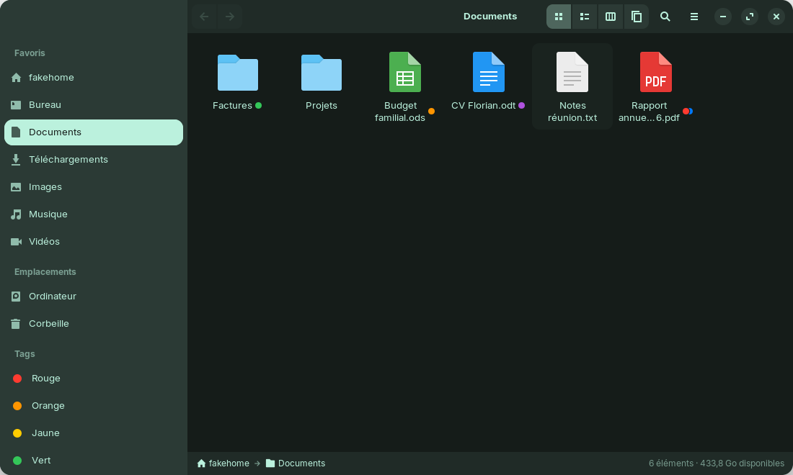
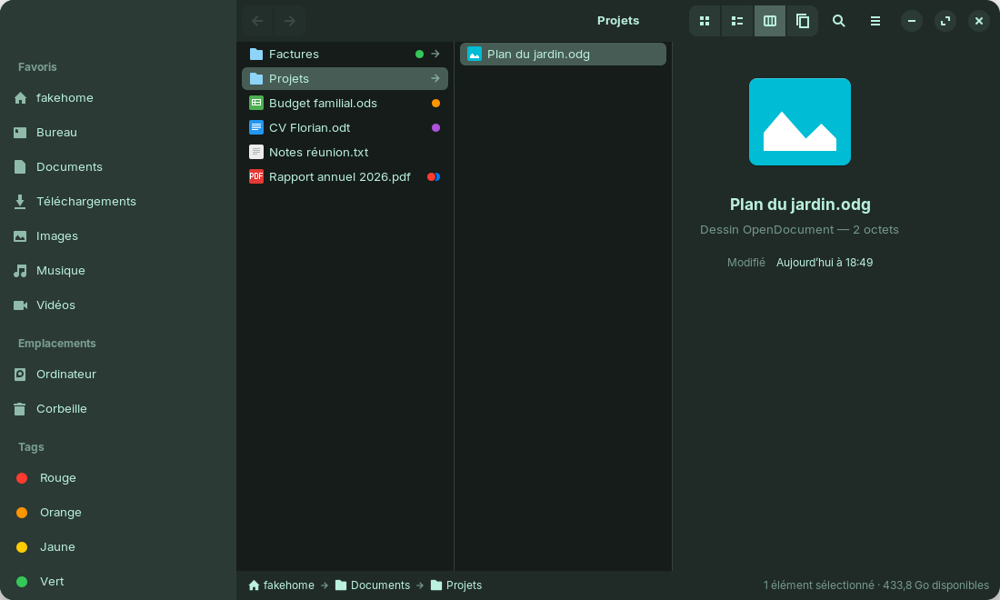
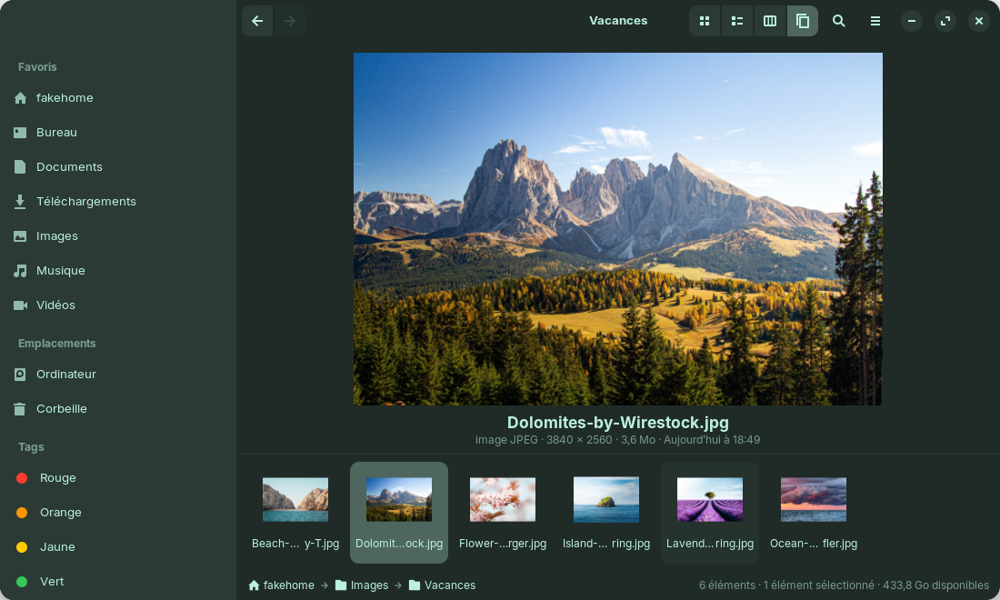
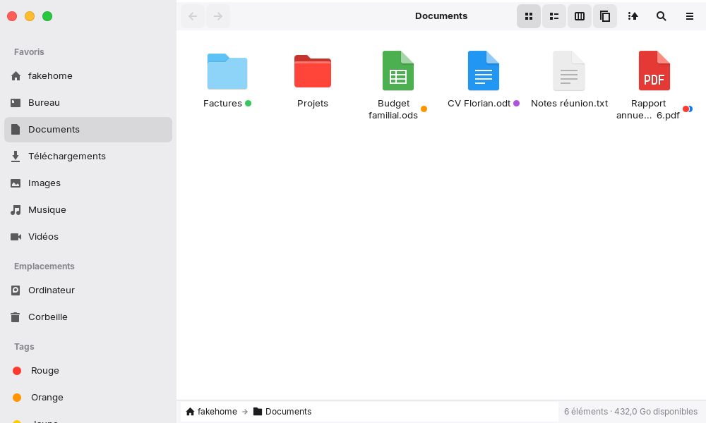
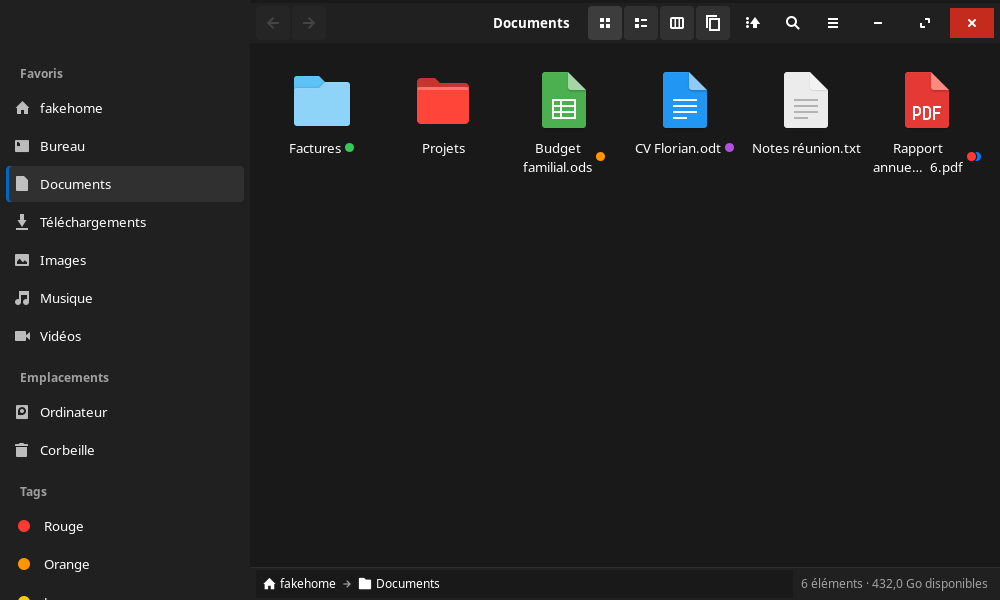
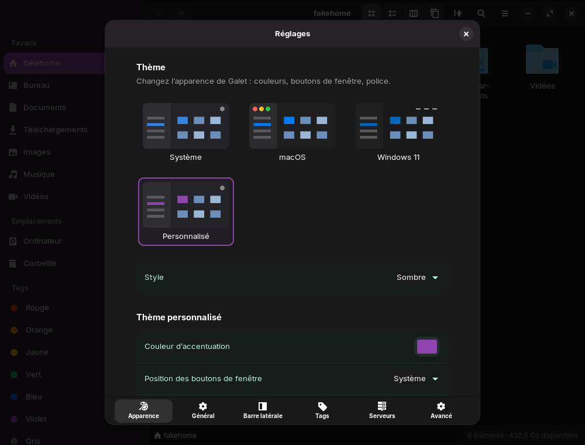

<p align="center">
  
</p>

# Galet — fiche de présentation et installation

*Un logiciel libre et open source créé par **Florian Dérail** — [florianderail.fr](https://florianderail.fr)*



## En bref

**Galet** est un explorateur de fichiers pour Linux, inspiré du **Finder d'Apple**.
Il est pensé pour Zorin OS, Ubuntu et tous les bureaux GNOME. C'est une application
**libre et gratuite** (licence GPL-3.0), écrite en Python avec GTK 4 et libadwaita :
elle s'intègre naturellement au thème et aux couleurs de votre système.

## Pourquoi Galet ?

> *« Je n'ai jamais trouvé un explorateur de fichiers qui me convienne vraiment. Alors j'ai
> décidé de développer le mien, pour qu'il corresponde exactement à ce que je voulais. »*
> — Florian Dérail, créateur de Galet

L'explorateur de GNOME est simple, mais il lui manque ce que les utilisateurs de Mac adorent :
les **tags de couleur**, la **vue en colonnes**, la **galerie**, les **actions rapides** ou les
**dossiers intelligents**. Galet les apporte, sans changer vos habitudes Linux. Et comme c'est un
logiciel libre, il peut maintenant convenir à d'autres aussi.

## Ce que Galet sait faire

| | |
|---|---|
| 🏷️ **Tags de couleur** | Clic droit → une pastille de couleur. Les tags apparaissent à côté des noms, et la barre latérale liste tous les fichiers d'un même tag. |
| 🗂️ **4 présentations** | Icônes, Liste (triable, groupable par type, date ou tag), **Colonnes** avec aperçu, **Galerie** (`Ctrl+1` à `Ctrl+4`). |
| 📑 **Onglets** | `Ctrl+T` pour ouvrir un onglet, glisser-déposer de fichiers sur un onglet. |
| 👁️ **Aperçus** | Coup d'œil avec `Espace`, panneau d'aperçu (`Ctrl+Maj+P`), « Lire les informations » (`Ctrl+I`), miniatures des photos, vidéos et PDF. |
| ⚡ **Actions rapides** | Pivoter, convertir en JPEG ou PNG, réduire une image, créer un PDF, compresser en ZIP, extraire une archive. |
| ↩️ **Confort** | Annuler (`Ctrl+Z`), renommer sur place (`F2`), dupliquer (`Ctrl+D`), sélection en tapant un nom, gestion des conflits de copie, barre de progression. |
| 🔍 **Recherche** | Dans le dossier, ses sous-dossiers ou tout le dossier personnel, avec filtres par type et par date. Les recherches s'enregistrent en **dossiers intelligents**. |
| 🌐 **Serveurs** | `Ctrl+K` : partages Windows (SMB), SFTP, FTP, WebDAV (Nextcloud, kDrive…), serveurs favoris dans la barre latérale. |
| 📱 **Envoi vers le téléphone** | Avec Zorin Connect ou GSConnect, comme AirDrop. |
| 🎨 **Thèmes** | Système, **macOS** (pastilles rouge-orange-vert à gauche), **Windows 11** ou **Personnalisé** (couleur, boutons, coins, police), en clair ou en sombre. |
| 📁 **Dossiers colorés** | Clic droit → « Couleur du dossier ». Chaque dossier retient aussi sa présentation, comme sur Mac. |
| ⚙️ **Réglages** | `Ctrl+,` : dossier de départ, présentation par défaut, taille des icônes, éléments de la barre latérale, tags, serveurs… |

| Colonnes | Galerie |
|---|---|
|  |  |

### Thèmes

Réglages (`Ctrl+,`) → **Apparence** : Système, macOS, Windows 11 ou Personnalisé, en clair ou en sombre.

| macOS | Windows 11 (sombre) |
|---|---|
|  |  |



Toutes les nouveautés de chaque version sont listées dans [CHANGELOG.md](../CHANGELOG.md).

### Où sont stockés les tags ?

Dans le fichier lui-même, dans un « attribut étendu » (`user.xdg.tags`), selon la norme
freedesktop. Le tag suit donc le fichier quand on le déplace ou le renomme, et KDE Dolphin
sait aussi le lire. Sur les disques qui ne le permettent pas (clés USB en FAT, serveurs
réseau), Galet garde les tags dans son propre index.

---

## Tutoriel : installer Galet sur Linux

Ce tutoriel couvre **Zorin OS 17/18, Ubuntu 24.04 et plus récents, Linux Mint 22,
Pop!_OS 24** et les autres distributions basées sur Debian ou Ubuntu.

### Étape 1 — Installer les dépendances

Ouvrez un terminal (`Ctrl+Alt+T`) et tapez :

```sh
sudo apt update
sudo apt install git python3-gi python3-gi-cairo gir1.2-gtk-4.0 gir1.2-adw-1 gnome-sushi
```

> Sur Zorin OS et Ubuntu récents, la plupart sont déjà installées : la commande ne fera que
> vérifier. `gnome-sushi` sert au Coup d'œil (touche `Espace`).

<details>
<summary>Fedora, Arch, openSUSE…</summary>

- **Fedora** : `sudo dnf install git python3-gobject python3-cairo gtk4 libadwaita sushi`
- **Arch / Manjaro** : `sudo pacman -S git python-gobject python-cairo gtk4 libadwaita sushi`
- **openSUSE** : `sudo zypper install git python3-gobject python3-gobject-cairo typelib-1_0-Gtk-4_0 typelib-1_0-Adw-1 sushi`

Il faut **GTK 4.12 ou plus** et **libadwaita 1.5 ou plus**.
</details>

### Étape 2 — Télécharger Galet

```sh
cd ~
git clone https://github.com/FloDerail/galet.git
cd galet
```

### Étape 3 — L'essayer sans rien installer

```sh
./bin/galet
```

La fenêtre s'ouvre. Rien n'est modifié sur votre système : vous pouvez juste fermer et
supprimer le dossier si Galet ne vous plaît pas.

### Étape 4 — L'installer

```sh
./install.sh
```

Galet apparaît alors dans le **menu des applications** (touche Super, tapez « Galet »).
Vous pouvez l'épingler dans la barre des tâches avec un clic droit → « Épingler ».
L'installation se fait **uniquement pour votre utilisateur**, sans `sudo`.

### Étape 5 (facultatif) — En faire l'explorateur par défaut

```sh
./install.sh --default
```

Les dossiers ouverts depuis le bureau, une clé USB ou le navigateur s'ouvriront dans Galet.

**Pour revenir à l'explorateur d'origine** :

```sh
xdg-mime default org.gnome.Nautilus.desktop inode/directory
```

### Mettre à jour

```sh
cd ~/galet
git pull
./install.sh
```

Puis fermez Galet (`Ctrl+Q`) et relancez-le.

### Désinstaller

```sh
cd ~/galet
./install.sh --remove
```

Vos tags et réglages sont conservés dans `~/.config/galet`. Supprimez ce dossier pour tout
effacer.

---

## En cas de problème

| Problème | Solution |
|---|---|
| `ValueError: Namespace Adw not available` | Installez `gir1.2-adw-1` (étape 1). Votre distribution doit fournir libadwaita 1.5 ou plus. |
| La touche `Espace` n'affiche rien | Installez `gnome-sushi`. |
| Galet n'apparaît pas dans le menu | Déconnectez-vous puis reconnectez-vous, ou lancez `update-desktop-database ~/.local/share/applications`. |
| Un bug ? | Joignez le fichier `~/.cache/galet/galet.log` à votre signalement sur la page *Issues* du projet GitHub. |

## L'auteur

Galet est conçu et développé par **Florian Dérail**.
🌐 Site : [florianderail.fr](https://florianderail.fr) · 💻 GitHub : [@FloDerail](https://github.com/FloDerail)

Galet est un **logiciel libre et open source** (licence GPL-3.0) : vous pouvez l'utiliser,
l'étudier, le modifier et le partager librement.

## Contribuer

Galet est un projet ouvert : traductions, idées, corrections et code sont les bienvenus.
Voir [CONTRIBUTING.md](../CONTRIBUTING.md).
